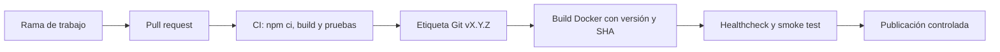

# Proceso de release

## Alcance

Este proceso describe cómo identificar una versión de la PWA, construirla y
validarla sin afirmar capacidades que todavía no están conectadas al CI o a un
registry externo.

La versión se expresa con SemVer `MAJOR.MINOR.PATCH` y se relaciona con una
etiqueta Git `vX.Y.Z`. Para esta actividad la versión objetivo es `0.10.0`.

- `MAJOR`: cambio incompatible de contrato o de datos.
- `MINOR`: funcionalidad compatible nueva.
- `PATCH`: corrección compatible.
- Una versión estable es un commit revisado, validado y etiquetado, no la
  etiqueta mutable `latest`.

## Flujo



El flujo previsto es:

1. Trabajar en `dev-oscar` y abrir un PR hacia la rama acordada por el equipo.
2. Revisar el diff y ejecutar las verificaciones locales disponibles.
3. Esperar CI antes de crear una etiqueta.
4. Crear la etiqueta manualmente, nunca desde un script automático:

   ```bash
   git tag -a v0.10.0 -m "Release v0.10.0"
   git show --stat --oneline v0.10.0
   ```

5. Generar `public/version.json` con `npm run version:generate`.
6. Construir la imagen con los objetivos existentes:

   ```bash
   make docker-build VERSION=0.10.0 COMMIT_SHA=$(git rev-parse --short HEAD)
   ```

7. Ejecutar el healthcheck del contenedor y el smoke test disponible cuando el
   responsable de pruebas lo integre.
8. Publicar solo después de que las verificaciones correspondan al mismo SHA.

Actualmente el repositorio no configura un registry externo ni contiene un
workflow de publicación de imágenes. La publicación debe coordinarse antes de
presentarla como automatizada.

### Fuentes del SHA

El generador aplica esta prioridad estricta:

1. `GIT_COMMIT_SHA`.
2. `VERSION_SHA`.
3. `git rev-parse HEAD`.

Las dos variables de entorno conservan su procedencia en `shaSource`. Cada
valor debe contener entre 7 y 40 caracteres hexadecimales. Un valor configurado
pero inválido provoca un error; no se continúa con Git ni se inventa un valor.
Si Git no está disponible y `REQUIRE_GIT_SHA=true`, la generación falla. Sin
esa exigencia, el resultado explícito es `sha: unavailable` y
`shaSource: unavailable`, lo cual debe rechazarse como release.

### Fecha reproducible

`SOURCE_DATE_EPOCH` permite fijar la fecha de generación como segundos Unix y
convertirla a ISO 8601 UTC. Sin esa variable se usa el reloj actual como
fallback controlado, por lo que dos ejecuciones no son idénticas. Una build
reproducible debe proporcionar el mismo `SOURCE_DATE_EPOCH` en todas sus
ejecuciones.

## Identificación de una release

`package.json` contiene la versión de aplicación y
`public/version.json` contiene:

- `version`: versión SemVer.
- `sha`: SHA Git completo o SHA recibido explícitamente por entorno.
- `date`: instante UTC de generación en ISO 8601.
- `shaSource`: `git`, `environment` o `unavailable`.

`npm run build` ejecuta primero `npm run version:generate` mediante el hook
`prebuild`. En un checkout Git local el SHA proviene de `git rev-parse HEAD`.
En Docker, `.dockerignore` excluye `.git`; por tanto, la construcción actual
debe coordinar un SHA mediante `GIT_COMMIT_SHA` o `VERSION_SHA`, y una fecha
mediante `SOURCE_DATE_EPOCH`. El Dockerfile actual no declara ni transmite
esos valores, por lo que esta integración queda pendiente del responsable de
Docker. No se ha comprobado que Docker los transmita correctamente.

## Criterios de aceptación

Aceptar una release solo si:

- `npm ci` y el build terminan correctamente.
- Las pruebas obligatorias pasan.
- El smoke test valida la aplicación, API, manifest, versión y Service Worker.
- El healthcheck responde correctamente.
- `version`, SHA y etiqueta Git corresponden al mismo commit.
- `shaSource` no es `unavailable`.
- La build Docker recibió explícitamente `GIT_COMMIT_SHA`/`VERSION_SHA` y
  `SOURCE_DATE_EPOCH`.
- No hay cambios incompatibles con los datos offline pendientes.

Rechazarla si falla cualquiera de esos puntos, si el SHA es `unavailable`, si
el Service Worker entrega recursos incompatibles o si el rollback no puede
identificarse de forma reproducible.

## Actualización del Service Worker

El registro actual ocurre en `/sw.js` desde
`src/lib/pwa/register-service-worker.ts`. El navegador compara el recurso del
worker cuando revisa el registro, instala el worker nuevo y el código actual
usa `skipWaiting()` y `clients.claim()` para activarlo de inmediato.

Actualmente no existe aviso visual, evento `updatefound` conectado a la UI ni
mensaje de confirmación al usuario. Tampoco se versiona la caché por release:
`public/sw.js` usa `pwa-inspections-v1`.

Por ello, la actualización de Service Worker requiere coordinación con el
responsable de PWA. No debe borrarse IndexedDB: allí pueden existir
inspecciones y operaciones pendientes de sincronización.
